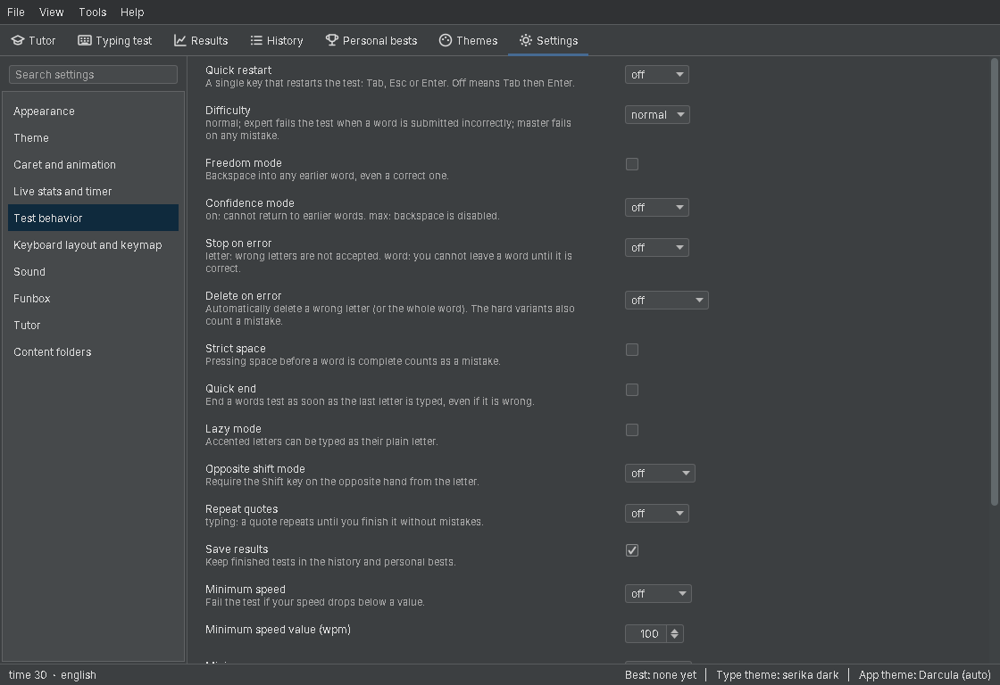

# TypeJunKey

A Java 17+ Swing desktop port of [Monkeytype](https://github.com/monkeytypegame/monkeytype) (v26.43.0) with a built-in typing tutor.
UI: FlatLaf (IntelliJ light / Darcula dark). Fonts: Inter (interface) and Cascadia (typing). Version no paralleled with MonkeyType Project.

#### Note : Vibe Coded, In-Development - Bugs may exist - Use with caution - Report Bugs and Feature Requirements!!!
    

## ❤️ Support This Project

If you enjoy using this software, you can support
its continued development!

### 🍕 Buy Me a Pizza  

## If you are an Indian Supporter
### 🇮🇳 Support via UPI

Scan this QR code using Google Pay, PhonePe or Paytm.

Thank you for supporting open-source development!

### Screens

#### Mode Toolbar

#### On-Type KeyMap

#### Test Results

#### Settings

## Build and run
- Maven / NetBeans: open the folder, `mvn package`, run `target/typejunkey-0.3.0.jar` (FlatLaf is shaded in).
- Plain JDK: `./build.sh` (Windows: `build.bat`), then `java -jar dist/TypeJunKey.jar`. FlatLaf comes from `lib/`.

## Side-by-side folders (next to the jar)
Create any of these folders next to `TypeJunKey.jar`. Files in them are loaded at startup, add to the bundled content,
and override a bundled file of the same name. Everything bundled can be removed (delete it from the jar with any zip
tool, or hide it in Tools > Manage content) without breaking the app: built-in fallbacks cover every case.

| folder | holds |
|---|---|
| `languages/` | Monkeytype word lists, `name.json` with a `words` array |
| `quotes/` | Monkeytype quote files, `name.json` |
| `themes/` | `name.css` with Monkeytype `--bg-color` style variables, or `name.json` |
| `layouts/` | Monkeytype keyboard layout files |
| `fonts/` | extra `.ttf` / `.otf` fonts (they appear in the font pickers) |
| `tutor/` | tutorials: `tutor/<level>/NN_title.txt` (see below) |

Tools > Open content folder creates all of them. The tutor folder can also be any folder, chosen on the Tutor tab.

## Tutor files
`tutor/<level>/03_index-finger-top-row.txt`. Levels: basic, beginner, intermediary, advanced, professional (extra
subfolders become extra levels). The title comes from the file name; lines starting with `#` are the instruction text;
all other lines are the exercise to type.

## Windows look
Settings > Appearance: "Auto Theme App With Type Theme" switches the window between Darcula and IntelliJ light to follow
the chosen type theme. The window frame is FlatLaf-drawn with square corners (setting "Window frame"; restart to apply).

## Regenerating bundled resources
`python3 tools/gen_resources.py <monkeytype-src> ` rebuilds themes, layouts, sounds, fonts and tutor lessons.

## License
Monkeytype is GPL-3.0 and this port reuses its word lists, quotes, themes and layouts, so TypeJunKey is GPL-3.0 (see LICENSE).
Inter and Cascadia Code are SIL Open Font License 1.1. FlatLaf is Apache 2.0.

## What is included (0.3)
All 94 Monkeytype settings that make sense on the desktop (Settings tab, searchable; also Ctrl+Shift+P command palette), all 48 funbox
modifiers, pace caret, sounds, on-screen keymap, tape mode, custom/random/OS-following themes, custom background, tutor.
Not included: accounts, leaderboards, ads, IME composition display, code-unindent option. Approximations: some funbox visuals
(nausea, crt, space_balls, choo_choo), keymap styles alice/steno (drawn as split/matrix), asl (no fingerspelling font),
tts (uses the system speech command), poetry/wikipedia (need internet).
