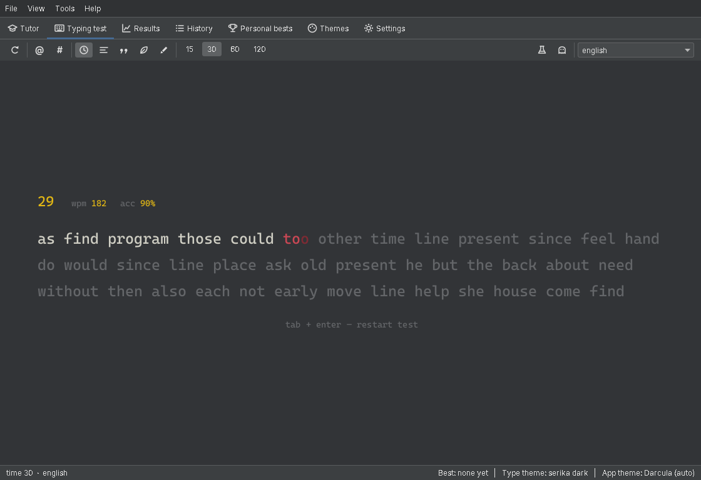
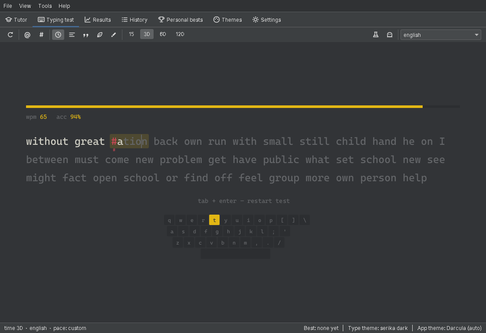
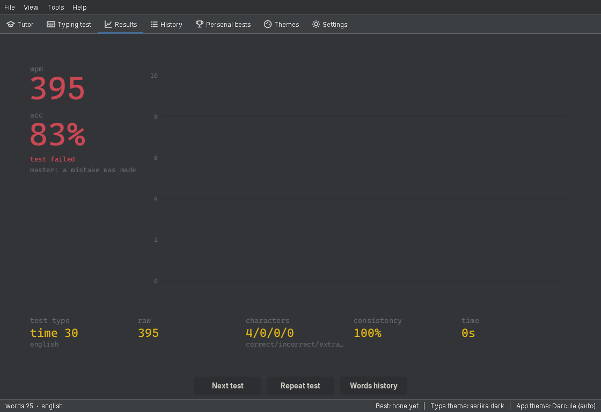

# TypeJunKey - Offline Typing Tutor and Tester

## Summary

**TypeJunKey** is an offline typing tutor and typing speed tester for the desktop, a Java port of the popular Monkeytype (v26.43.0). Learn touch typing with the guided **Tutor**, then test your speed and accuracy with a wide range of modes, word lists, languages and themes - all without an internet connection.

## Development Status

#### Note : Vibe Coded, In-Development - Bugs may exist - Use with caution - Report Bugs and Feature Requirements!!!

  

---

## ❤️ Support This Project

If you enjoy using this software, you can support
its continued development!

### 🍕 Buy Me a Pizza  
<a href="https://buymeacoffee.com/sahasrarachakra?l=en">
  
</a>


## If you are an Indian Supporter
### 🇮🇳 Support via UPI

Scan this QR code using Google Pay, PhonePe or Paytm.


Thank you for supporting open-source development!

---

## Screens

#### Mode Toolbar


#### On-Type KeyMap


#### Test Results


#### Settings


## Features

- **Tutor** tab: guided typing lessons from basic to professional, with on-screen keyboard, line-drawn hands and highlighted finger/key for the next character
- **Typing test** with Monkeytype-style modes, settings, tweaks and animations (including smooth caret animation)
- All Monkeytype word lists, languages, quotes and themes bundled
- Side-by-side folders next to the app for **custom word lists, quotes, themes and tutor lessons** (these override bundled ones)
- Bundled content can be removed without crashing the app
- FlatLaf **IntelliJ (light)** and **Darcula (dark)** looks, with *Auto Theme App With Type Theme*
- Inter UI font and Cascadia Mono typing font; choose font family, style and size
- Selectable keyboard layout for tutor and test
- 100% offline

## Prerequisites for Running

- Windows, Linux or macOS
- **Java 17 or later** (JRE or JDK) - check with `java -version`
- About 200 MB of free disk space

## How to Run

1. Download the latest release (`TypeJunKey.jar`) from the **Releases** page of this repository.
2. Make sure Java 17 or later is installed (`java -version`).
3. Double-click the `.jar` file, **or** run it from a terminal:

```bash
java -jar TypeJunKey.jar
```

> On Windows you can also create a shortcut to `javaw -jar TypeJunKey.jar` to start it without a console window.

**Optional custom content:** create folders next to `TypeJunKey.jar` (for example `languages/`, `quotes/`, `themes/` and `tutor/`) and place your own files there. They are loaded at startup and override the bundled ones.

## How to Use

1. Start on the **Tutor** tab to learn typing: pick a level (basic, beginner, intermediary, advanced, professional) and a lesson, then follow the highlighted finger and key.
2. Switch to the **Typing test** tab, choose a mode (time, words, quote, zen, custom), language and difficulty, and start typing - the test begins with your first key press.
3. View your WPM, accuracy, consistency and raw speed on the results screen.
4. Open **Settings** to change theme, fonts, caret style, keyboard layout, sounds and behaviour.
5. To add your own lessons, put serially numbered text files in the `tutor/<level>/` folders next to the app.

## Keyboard Shortcuts

| Shortcut | Action |
|---|---|
| `Tab` then `Enter` | Restart test |
| `Esc` | Open command line / dismiss dialogs |
| `Shift + Enter` | Restart test (alternate) |
| `Ctrl + Shift + P` | Command palette |
| `Ctrl + Backspace` | Delete previous word while typing |

<!-- Verify this table against the shortcuts actually implemented in your build. -->

## Prerequisites for Building

- **JDK 17 or later**
- **FlatLaf 3.8** (`flatlaf-3.8.jar`) in `lib/`
- Bundled fonts: **Inter** and **Cascadia Code** families (TTF files in `resources/fonts/`)
- Monkeytype v26.43.0 `frontend/static` data (languages, quotes, themes) in `resources/`
- An IDE (NetBeans / IntelliJ IDEA / VSCodium) or the command line
- Git

## How to Build

1. Clone the repository:

```bash
git clone https://github.com/SahasraraChakra/TypeJunkey.git
cd TypeJunkey
```

2. **Using an IDE:** open the project in NetBeans (or IntelliJ IDEA / VSCodium with Java extensions), make sure the project JDK is 17+, add the libraries from the `lib/` folder to the classpath, then choose **Run / Build**.

3. **Using the command line:**

```bash
# Windows (use ':' instead of ';' on Linux/macOS)
mkdir out
javac -cp "lib/*" -d out -sourcepath src src/com/jsoft/typejunkey/Main.java
jar cfe TypeJunKey.jar Main -C out .
```

> Adjust the main class and paths above to match your project layout. Copy any resource folders (fonts, images, `.properties` themes) into the output before packaging, if your IDE does not do this automatically.

## Copyright

© JSoft Bharath, Kerala, India & Jeevan Kumar Vishwakarman. All rights reserved.

**TypeJunKey - Offline Typing Tutor and Tester Developed By : JSoft Bharath, Kerala, India. / Jeevan Kumar Vishwakarman. All Rights Reserved To : JSoft Bharath, Kerala, India. / Jeevan Kumar Vishwakarman.**

## License

**Attribution-Required, No-Modification, No-Resale License**

Copyright © JSoft Bharath, Kerala, India & Jeevan Kumar Vishwakarman ("the Authors").

Permission is hereby granted, free of charge, to any person or organization obtaining a copy of this software and its source code ("the Software") to **use** the Software, for personal or commercial purposes, subject to the following conditions:

1. **Attribution is compulsory.** Any use of the Software, in any application, product, service, documentation or website, must display the following attribution text, in bold, in a place reasonably visible to users (for example an About dialog, credits screen, README or product page):

   **TypeJunKey - Offline Typing Tutor and Tester Developed By : JSoft Bharath, Kerala, India. / Jeevan Kumar Vishwakarman. All Rights Reserved To : JSoft Bharath, Kerala, India. / Jeevan Kumar Vishwakarman.**

2. **No modification.** You may not change, modify, adapt, translate, decompile, reverse-engineer or create derivative works of the Software's code or binaries. The Software must be used exactly as distributed by the Authors.

3. **No selling or charging for the Software.** You may not sell, rent, sublicense, or charge any fee for the Software or its code, in whole or in part, or bundle it in a way that charges for the Software itself. You **may** charge for your own applications, products and services that use the Software, provided the Software itself is not what is being sold and condition 1 is met.

4. **Redistribution.** You may redistribute the unmodified Software free of charge only if this license, the copyright notice and the attribution text are kept intact.

5. **Ownership.** The Software is licensed, not sold. All rights not expressly granted are reserved by the Authors.

6. **Termination.** Any breach of these terms automatically terminates your rights under this license.

THE SOFTWARE IS PROVIDED "AS IS", WITHOUT WARRANTY OF ANY KIND, EXPRESS OR IMPLIED, INCLUDING BUT NOT LIMITED TO THE WARRANTIES OF MERCHANTABILITY, FITNESS FOR A PARTICULAR PURPOSE AND NONINFRINGEMENT. IN NO EVENT SHALL THE AUTHORS BE LIABLE FOR ANY CLAIM, DAMAGES OR OTHER LIABILITY, WHETHER IN AN ACTION OF CONTRACT, TORT OR OTHERWISE, ARISING FROM, OUT OF OR IN CONNECTION WITH THE SOFTWARE OR THE USE OR OTHER DEALINGS IN THE SOFTWARE.

For permission requests beyond these terms, contact the Authors via the repository's Issues page.
